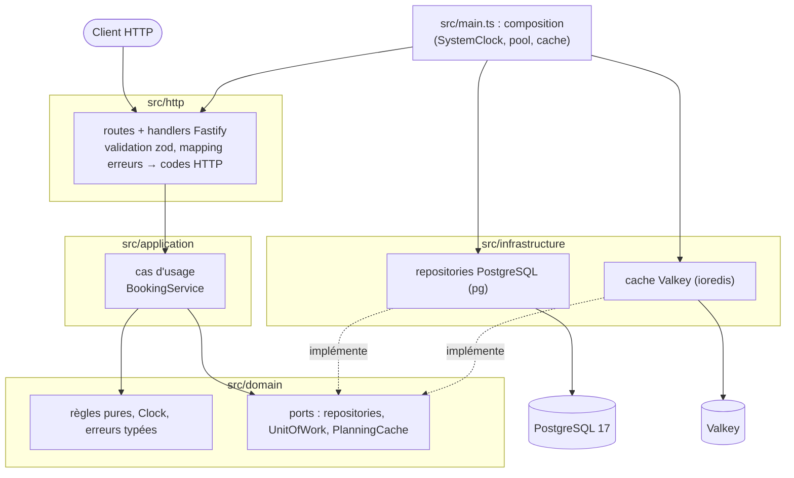
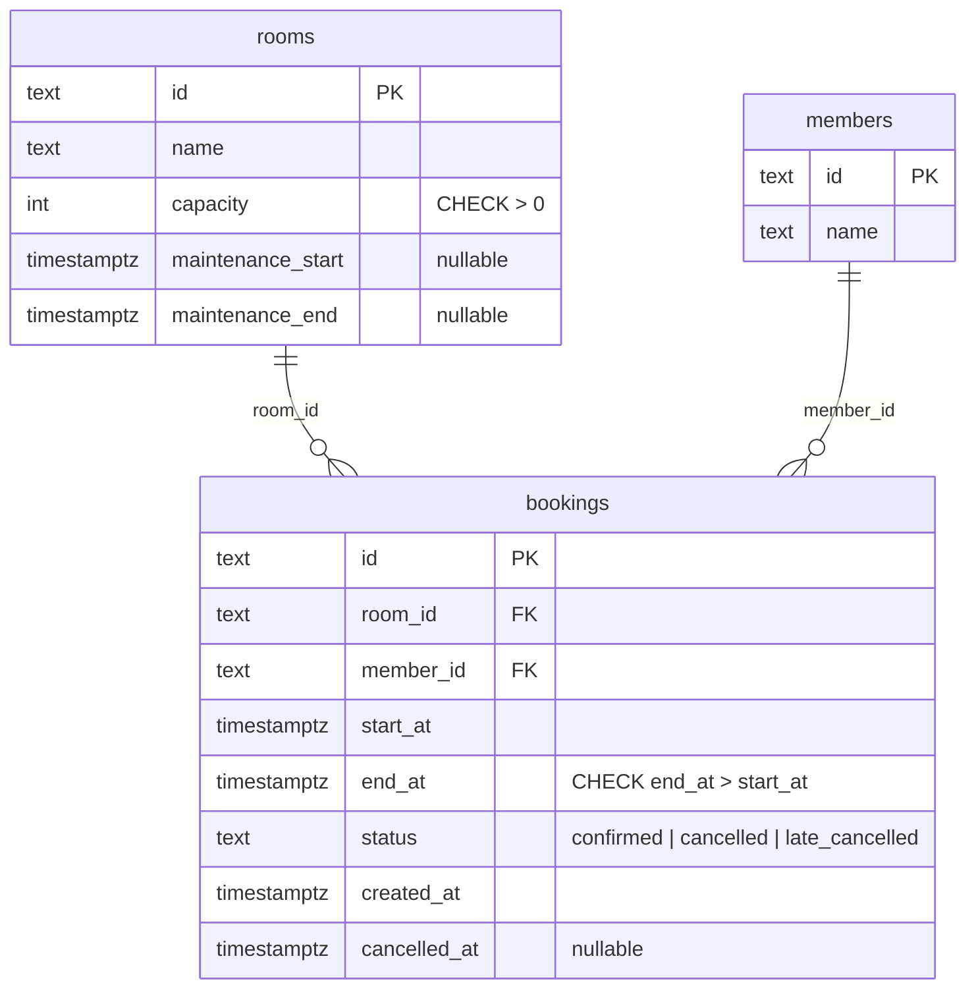

# DECISIONS — Studio Riff

Toutes les heures sont en UTC : `timestamptz` en base, ISO 8601 avec `Z` dans l'API.

## 1. Où vit chaque règle métier, et pourquoi

Principe : une règle est un fait métier, pas un détail HTTP ni SQL. Elle est écrite une fois dans
`src/domain` (fonctions pures, testables sans base ni serveur). Les couches `application` et
`infrastructure` fournissent seulement les données et la transaction dont la règle a besoin.
Quand la règle dépend de l'heure, elle reçoit une `Clock` en paramètre ; seule `SystemClock`
(créée dans `src/main.ts`) lit l'heure réelle.

| # | Règle | Implémentation | Pourquoi là |
|---|-------|----------------|-------------|
| 1 | Créneau de 1 à 4 h, heure pleine, entre 10 h et 23 h | `domain/slot.ts` → `validateSlot()` | Règle sur une seule réservation, sans accès aux données : fonction pure, testée à la minute près. Elle est appelée en premier (échec rapide, avant tout accès à la base) et donne un 400. Une contrainte `CHECK` SQL n'ajouterait que de la duplication sur une règle susceptible d'évoluer ; la base garde seulement `end_at > start_at`. |
| 2 | Pas de chevauchement dans une salle, même en concurrence | Domaine : `domain/booking.ts` → `assertNoOverlap()` ; base : contrainte `EXCLUDE USING gist` | **Double rempart.** Le domaine donne un message clair dans le cas courant. Mais lire puis écrire n'est pas atomique : deux requêtes simultanées passent toutes les deux la vérification. Seule la base peut trancher, car la contrainte d'exclusion est évaluée de façon atomique à l'`INSERT`. L'erreur PostgreSQL `23P01` est traduite en `SlotOverlap` (409). |
| 3 | 2 réservations à venir au plus par membre | `domain/booking.ts` → `assertMemberUnderLimit()`, appelée par le cas d'usage `createBooking` dans une transaction qui **verrouille la ligne du membre** (`SELECT … FOR UPDATE`) | Voir ci-dessous. |
| 4 | Annulation : `cancelled` / `late_cancelled`, jamais deux fois | `domain/booking.ts` → `cancelBooking(booking, clock)` | Dépend de l'heure : la `Clock` est injectée, un test fige l'horloge au 2 nov. 2026 à 9 h. L'enregistrement n'est jamais supprimé (`UPDATE` du statut). Le verrou de ligne (`FOR UPDATE`) sur la réservation empêche deux `DELETE` simultanés de passer tous les deux. |
| 5 | Maintenance : refuser tout ce qui empiète | `domain/room.ts` → `assertOutsideMaintenance()` | Règle pure à partir des dates de maintenance de la salle, chargée avec la salle. Les bornes sont des intervalles semi-ouverts : un créneau qui se termine à l'instant où la maintenance commence, ou qui commence à l'instant où elle finit, est accepté. |

### La limite de 2 réservations à venir

C'est la règle qui porte sur un **ensemble** de réservations : elle ne peut pas être une contrainte
`CHECK` ni `UNIQUE` sur une ligne. Les options étudiées :

- **Dans le handler HTTP** : refusé, la règle serait invisible du domaine et contournée par tout autre point d'entrée.
- **Dans le domaine seul, lire puis insérer** : incorrect. Deux `POST` simultanés du même membre lisent « 1 réservation à venir » et créent chacun la deuxième, soit 3 au total (*write skew* : les deux insertions touchent des lignes différentes, aucune contrainte ne se déclenche).
- **Trigger SQL** : fonctionne, mais cache une règle métier dans la base, difficile à tester avec une horloge fixe (`now()` n'est pas injectable).
- **Retenu** : la règle reste dans le domaine (testable avec une horloge fixe), et le cas d'usage la protège
  par une transaction qui prend un verrou de ligne sur le **membre** (`SELECT … FROM members WHERE id = $1 FOR UPDATE`)
  avant de compter. Les créations concurrentes du même membre sont sérialisées ; celles de membres
  différents ne se bloquent pas. Le verrou suit le périmètre de la règle (le membre), pas celui du
  chevauchement (la salle). Une réservation « à venir » est une réservation `confirmed` dont le début est
  strictement postérieur à l'instant de l'horloge.

Alternatives écartées : `SERIALIZABLE` avec nouvelle tentative (plus de code de reprise, erreurs
`40001` à gérer) et advisory lock (même effet que le verrou de ligne, mais moins lisible).

### Interprétations retenues

- « Entre 10 h et 23 h » : le créneau tient dans la plage ; début ≥ 10 h et fin ≤ 23 h, le jour même. Un créneau 22 h → 23 h est valide, 22 h → 24 h ne l'est pas. Cohérent avec les 13 créneaux du script de génération (début de 10 h à 22 h).
- La durée est un nombre entier d'heures, de 1 à 4 ; début et fin sont à une heure pleine (minutes, secondes et millisecondes à 0).
- Seules les réservations `confirmed` bloquent un créneau et comptent pour la limite : une réservation annulée libère la salle (la contrainte d'exclusion est partielle : `WHERE status = 'confirmed'`).
- Annulation à exactement 24 h avant le début : `cancelled` (« moins de 24 h » est strict). Une annulation après le début est aussi `late_cancelled`.
- Le sujet ne parle pas des réservations dans le passé : elles ne sont pas refusées.
- Ordre des vérifications d'une création : 400 (forme/créneau) → 404 salle → 404 membre → 409 maintenance → 409 limite → 409 chevauchement.

## 2. Schéma des couches

Règles de dépendance : `http → application → domain` ; `infrastructure → domain` (elle implémente ses ports) ;
le domaine n'importe ni Fastify, ni `pg`, ni `ioredis`. Seul `main.ts` connaît toutes les couches.

## 3. Modèle relationnel

Contraintes : `CHECK` sur la capacité, sur la cohérence des deux dates de maintenance (les deux nulles ou
`maintenance_end > maintenance_start`), sur le statut et sur `end_at > start_at` ; contrainte d'exclusion
`EXCLUDE USING gist (room_id WITH =, tstzrange(start_at, end_at, '[)') WITH &&) WHERE (status = 'confirmed')`
(extension `btree_gist`). Index sur `bookings(member_id)` pour la liste des réservations d'un membre.

## 4. ADR

### ADR 1 — `pg` en SQL brut plutôt qu'un ORM

- **Contexte** : le cœur du problème est dans PostgreSQL (contrainte d'exclusion `tstzrange`/`gist`, verrou `FOR UPDATE`, code d'erreur `23P01`, `EXPLAIN ANALYZE`). Le schéma tient en trois tables.
- **Décision** : driver `pg` (node-postgres), requêtes SQL écrites à la main dans les repositories, migrations en fichiers `.sql` numérotés appliqués par un petit script.
- **Conséquences** : (+) aucune abstraction entre nous et les fonctionnalités PostgreSQL utilisées, les requêtes mesurées sont exactement celles exécutées ; (+) peu de dépendances. (−) mapping ligne → objet à écrire à la main ; (−) pas de typage généré. Acceptable pour 3 tables. Un ORM serait à reconsidérer si le schéma grossissait fortement.

### ADR 2 — Refus du MVC classique au profit de couches domaine / application / infrastructure

- **Contexte** : une API JSON n'a pas de vue. Dans un MVC classique, les règles finissent dans les contrôleurs ou dans des modèles liés à l'ORM, donc difficiles à tester sans HTTP ni base, et la règle de l'horloge (injectée) devient pénible.
- **Décision** : quatre dossiers aux dépendances orientées vers le domaine. Le domaine contient les règles pures et définit les ports (repositories, `UnitOfWork`, cache) ; l'infrastructure les implémente ; les handlers HTTP se limitent à valider l'entrée, appeler un cas d'usage et traduire erreurs et résultats en codes HTTP.
- **Conséquences** : (+) règles testées en millisecondes avec une horloge fixe, sans base ; (+) le cache Valkey est un détail remplaçable (adaptateur « sans cache » utilisé dans les tests et en repli) ; (−) plus de fichiers et un peu de code de liaison pour une petite application. Le coût reste faible et il est payé une fois.
